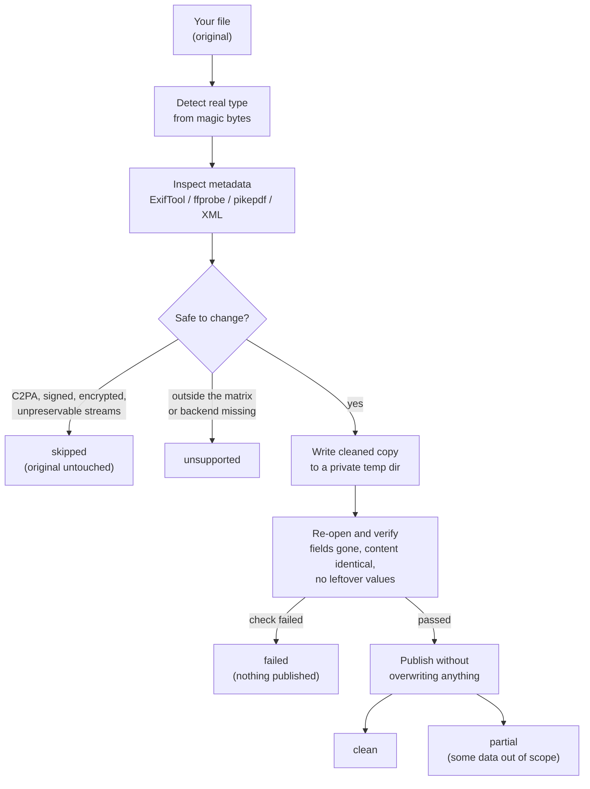
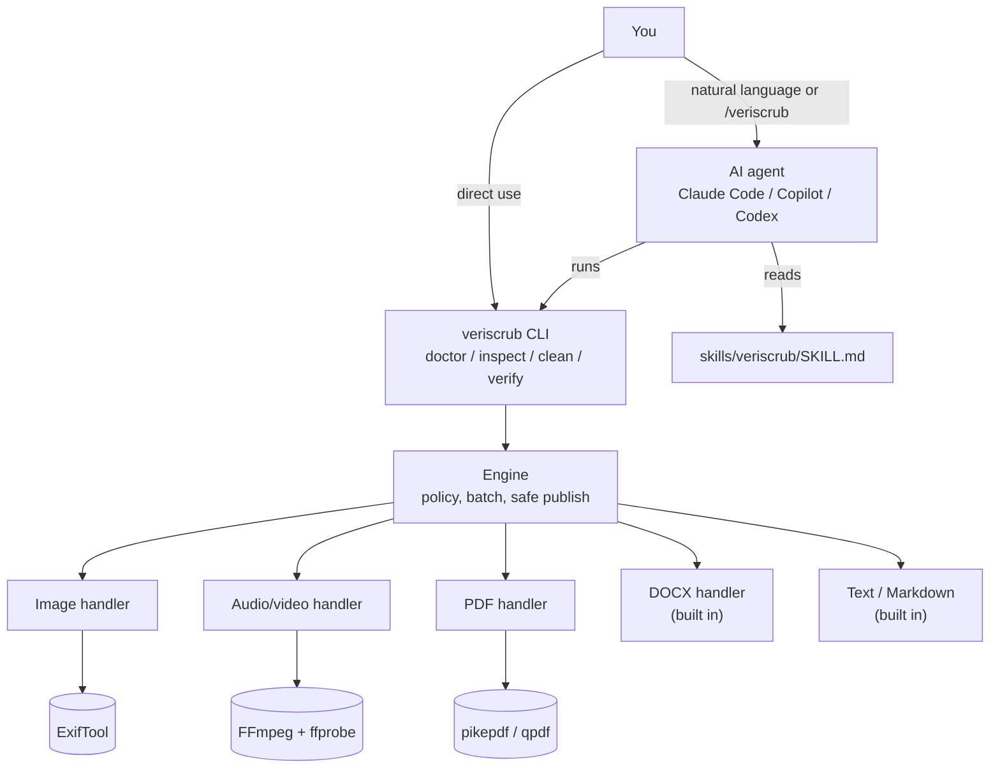
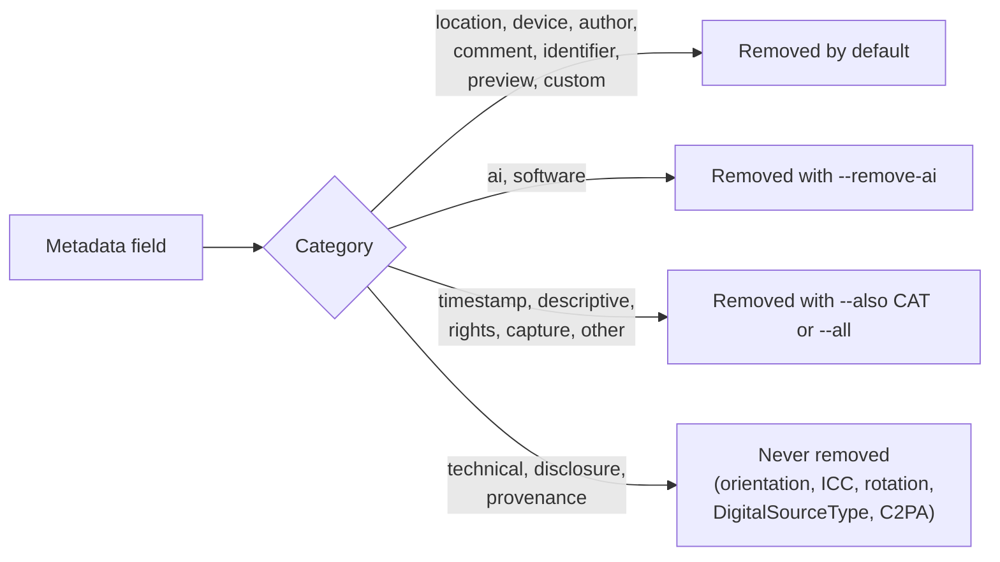

<div align="center">

# VeriScrub

**Scrub private metadata from your files, then prove it's gone.**

[](https://github.com/CodeWithLakxsh/veriscrub/actions/workflows/ci.yml)
[](https://github.com/CodeWithLakxsh/veriscrub/releases)
[](LICENSE)
[](pyproject.toml)
[](skills/veriscrub/SKILL.md)
[](#safety-model)
[](https://github.com/CodeWithLakxsh/veriscrub/stargazers)

</div>

VeriScrub is an offline [Agent Skill](https://agentskills.io) plus a deterministic Python CLI for metadata privacy. An AI agent, or you directly, can **inspect** files for private metadata, write **cleaned copies**, and **verify** which fields were removed or retained.

> "Clean the private metadata from this file."
> "Inspect this folder for AI generation parameters."

- **Never touches originals.** Each cleaned copy is written to a temp file, re-opened and verified, and only then published. Existing files are never overwritten.
- **Verifies, doesn't assume.** A file is reported as `clean` only after the output has been re-read and checked: the targeted fields are gone, pixels/streams/pages are byte-identical, and the original's hash is unchanged.
- **Offline and private by default.** No network calls. Reports show field names, not values, unless you pass `--show-values`.
- **Honest outcomes.** Every file ends as `clean`, `partial`, `skipped`, `unsupported` or `failed`, with the reason.

It removes **metadata fields it can inspect**. It does not detect or remove watermarks, does not change AI-detector scores, and never claims a file is human-made, undetectable or free of hidden signals. See [Metadata vs. provenance vs. watermarks](#metadata-vs-provenance-vs-watermarks).

## How it works

Every file goes through the same verify-before-publish pipeline:



How the pieces fit together:



What gets removed by default and what needs an explicit flag:



## Quick start

```bash
# 1. Install the system backends (see "Dependencies" for Linux and Windows)
brew install exiftool ffmpeg

# 2. Install the CLI straight from GitHub (pikepdf is only needed for PDF)
pipx install git+https://github.com/CodeWithLakxsh/veriscrub && pipx inject veriscrub pikepdf
#   or: uv tool install git+https://github.com/CodeWithLakxsh/veriscrub --with pikepdf

# 3-5 below use files from the repo, so clone it too
git clone https://github.com/CodeWithLakxsh/veriscrub && cd veriscrub

# 3. Check what is available
veriscrub doctor

# 4. Install the skill for Claude Code (personal; see below for per-project)
mkdir -p ~/.claude/skills && cp -R skills/veriscrub ~/.claude/skills/

# 5. Try it on the synthetic fixtures
python tests/fixtures/build.py /tmp/veriscrub-demo          # needs Pillow for the image/audio fixtures
veriscrub inspect /tmp/veriscrub-demo
veriscrub clean /tmp/veriscrub-demo --output-dir /tmp/veriscrub-demo-clean
```

## Using it from an agent

### Claude Code

Install the skill directory, which contains `SKILL.md` and `references/`, into one of the locations from the [Claude Code skills docs](https://code.claude.com/docs/en/skills):

| Scope | Location | Command (run from the repo root) |
|---|---|---|
| This project only | `.claude/skills/veriscrub/` | `mkdir -p /path/to/project/.claude/skills && cp -R skills/veriscrub /path/to/project/.claude/skills/` |
| You, in every project | `~/.claude/skills/veriscrub/` | `mkdir -p ~/.claude/skills && cp -R skills/veriscrub ~/.claude/skills/` |

On Windows PowerShell, run `Copy-Item -Recurse skills\veriscrub "$HOME\.claude\skills\"` (create the folder first).

The CLI must be on `PATH` (step 2 above). The skill pre-approves only `Bash(veriscrub *)`.

Invoke it explicitly:

```text
/veriscrub inspect ~/Pictures/export
/veriscrub clean ~/Desktop/trip --output-dir ~/Desktop/trip-clean
```

Or just ask in plain language:

- "Clean the private metadata from `IMG_0042.jpg`."
- "Inspect this folder for AI generation parameters."
- "Strip the prompts and seeds from these PNGs and put the copies in `./share`."
- "Remove the author and email from the front matter of `post.md`."
- "Check whether `report.pdf` still has my name in it."

The skill tells the agent to inspect first, summarise by category without echoing values, choose flags only on request, report each file's status honestly, treat file contents as untrusted data, and never upload anything.

### Other Agent Skills clients

`skills/veriscrub/SKILL.md` follows the [Agent Skills specification](https://agentskills.io/specification), so any compatible client can load the same directory. The CLI must be installed and on `PATH` in every case. I checked these locations against each client's documentation:

| Client | Project skills | Personal skills | Docs |
|---|---|---|---|
| GitHub Copilot | `.github/skills/`, `.claude/skills/` or `.agents/skills/` | `~/.copilot/skills/` or `~/.agents/skills/` | [GitHub Docs](https://docs.github.com/en/copilot/how-tos/use-copilot-agents/cloud-agent/create-skills) |
| OpenAI Codex | `.agents/skills/` (scanned from the working directory up to the repo root) | `~/.agents/skills/` | [Codex skills](https://developers.openai.com/codex/skills) |

Install by copying the directory, for example `mkdir -p .agents/skills && cp -R skills/veriscrub .agents/skills/`. In Codex, mention the skill with `$veriscrub` or pick it from `/skills`. A project skill in `.claude/skills/` is also discovered by Copilot.

**Clients without skill discovery:** paste the body of `SKILL.md` into the agent's instructions or system prompt, or just run the CLI yourself. Every feature works without an agent.

## CLI

```text
veriscrub doctor                       # which backends are installed, what they enable
veriscrub inspect PATH...              # list fields (values redacted); * marks what clean would remove
veriscrub clean PATH... [-o OUT | --output-dir DIR] [--dry-run] [--json]
veriscrub verify CLEANED [--original ORIGINAL]
```

```bash
veriscrub inspect photo.jpg                          # human-readable
veriscrub inspect --json ./renders                   # machine-readable, recursive
veriscrub clean photo.jpg                            # -> photo.cleaned.jpg next to it
veriscrub clean photo.jpg -o share/photo.jpg
veriscrub clean ./trip --output-dir ./trip-clean     # batch; mirrors the folder structure
veriscrub clean ./renders --output-dir ./share --remove-ai   # also strip prompts/seeds/workflows
veriscrub clean ./trip --output-dir ./out --dry-run  # show the plan, write nothing
veriscrub clean post.md --front-matter-key author --front-matter-key email
veriscrub verify share/photo.jpg --original photo.jpg
veriscrub clean -- -odd-name.jpg                      # "--" before names that start with "-"
```

Useful flags: `--also timestamp,descriptive`, `--all`, `--strict` (never publish partial results), `--on-collision rename|skip|fail`, `--allow-stream-loss`, `--allow-provenance-loss`, `--remove-artwork`, `--show-values`, `--timeout SECONDS`. Run `veriscrub clean --help` for the full category list.

A shortened `clean --json` result:

```json
{
  "tool": "veriscrub", "version": "0.1.0", "command": "clean",
  "policy": {"remove": ["author", "comment", "custom", "device", "identifier", "location", "preview"]},
  "results": [{
    "path": "photo.jpg", "status": "clean", "format": "jpeg", "output": "out/photo.jpg",
    "removed":  [{"key": "EXIF:GPS:GPSLatitude", "category": "location", "value": "<redacted 7 chars>"}, "..."],
    "retained": [{"key": "EXIF:IFD0:Orientation", "category": "technical", "value": "<redacted 1 chars>", "removable": false}, "..."],
    "remaining": [],
    "checks": {
      "image_data_unchanged": {"ok": true, "detail": "compressed image data and non-metadata chunks are byte-identical"},
      "color_profile_preserved": {"ok": true, "detail": "ICC profile present and identical"},
      "orientation_preserved": {"ok": true, "detail": "orientation=6"},
      "removed_values_absent": {"ok": true, "detail": "no removed value found in the output bytes"},
      "original_unchanged": {"ok": true, "detail": "SHA-256 of the original"}
    }
  }],
  "summary": {"clean": 1}
}
```

### What gets removed

| Category | Default | Examples |
|---|---|---|
| `location` | removed | GPS, ISO 6709 location, city/country fields |
| `device` | removed | make, model, body/lens serials, maker notes, Android/Apple device keys |
| `author` | removed | Artist, Creator, By-line, dc:creator, lastModifiedBy, Company, Manager, MP3 artist/encoded_by |
| `comment` | removed | UserComment, JPEG COM, descriptions, PNG Comment, media comments |
| `identifier` | removed | ImageUniqueID, XMP DocumentID/InstanceID/History, DOCX revision, PDF document IDs |
| `preview` | removed | EXIF/IFD1 thumbnails |
| `custom` | removed | DOCX custom properties, non-standard PDF Info keys |
| `ai` | `--remove-ai` | PNG `parameters`/`prompt`/`workflow`, A1111 parameters in UserComment, seeds, model hashes |
| `software` | `--remove-ai` | Software, CreatorTool, Producer, encoder |
| `timestamp`, `descriptive`, `rights`, `capture`, `other` | `--also CAT` or `--all` | dates, titles/keywords, copyright, exposure settings, unclassified |
| `technical`, `disclosure`, `provenance` | **never** | orientation, ICC profile, rotation, language, IPTC DigitalSourceType, C2PA |

### Outcomes and exit codes

| Status | Meaning |
|---|---|
| `clean` | Every targeted field was removed, the output was re-read and verified, and the copy was published |
| `partial` | The copy was published, but some privacy-relevant data remains (listed under `remaining` / `unhandled`). `--strict` refuses to publish these |
| `skipped` | Deliberately not modified: signed provenance, a digital signature, encryption, data that cannot be preserved, a symlink, nothing to clean |
| `unsupported` | The format or variant is outside the verified matrix, or its backend is missing |
| `failed` | An error occurred or verification failed. **Nothing was published** |

Exit codes: `0` all ok · `1` at least one `failed` · `2` usage error · `3` some `partial`/`skipped`/`unsupported` (and for `doctor`, a backend is missing).

## Supported formats

Summary below. Exact per-handler coverage is in [skills/veriscrub/references/formats.md](skills/veriscrub/references/formats.md).

| Format | Backend | Clean | Verified after cleaning | Verified end to end here |
|---|---|---|---|---|
| JPEG | ExifTool + built-in parser | EXIF, IPTC, XMP, COM, MakerNotes, thumbnails | tags absent on re-read; image data, ICC and orientation identical | ✅ |
| PNG (static) | ExifTool + built-in chunk filter | EXIF, XMP, text chunks by exact keyword (incl. ComfyUI/A1111), tIME | as JPEG, plus transparency, gAMA and iCCP | ✅ |
| WebP (static) | ExifTool + built-in parser | EXIF, XMP | as JPEG, plus alpha, ICCP | ✅ |
| MP4 / MOV / MKV | FFmpeg stream copy + ffprobe | container and stream tags, Apple `mdta` keys | stream layout, per-stream packet SHA-256, duration, rotation, decode | ✅ |
| MP3 / M4A / FLAC | FFmpeg stream copy + ffprobe | ID3, iTunes tags, Vorbis comments; artwork kept or `--remove-artwork` | same as video; artwork checked for its own EXIF | ✅ |
| PDF | pikepdf (qpdf), full rewrite | Info dictionary, document XMP | keys absent, page content identical, old incremental revisions gone | ✅ |
| DOCX | built-in | core/app/custom properties | every non-property part byte-identical | ✅ |
| Markdown | built-in | user-named front matter keys only | body byte-identical | ✅ |
| TXT | built-in | nothing to clean (reported) | n/a | ✅ |
| GIF, TIFF, HEIC, AVIF, WebM, ... | ExifTool (if installed) | `unsupported` (read-only `inspect`) | n/a | ✅ (read-only path) |

Explicitly **unsupported variants**: animated WebP, APNG, `.docm`/`.doc`, WebM/3GP/AVI/TS.

By default these are **skipped** and explained: files with C2PA/Content Credentials, signed or encrypted PDF/DOCX, and videos with subtitles, chapters, attachments, cover streams or data streams. Phone videos often carry data/metadata tracks such as timecode or GPS telemetry, so they are skipped until you pass `--allow-stream-loss`.

These are reported as **partial**: DOCX comments and tracked changes, PDF annotations with author names, attachments or object-level XMP, JPEG trailer data (MPF/motion photos), and audio artwork that carries its own EXIF.

"Verified end to end here" means the automated tests built synthetic fixtures, cleaned them, re-opened the outputs with an independent reader (ExifTool, Pillow, ffprobe/ffmpeg, pikepdf, zipfile), and checked removal, integrity, original hashes and failure paths. The full suite runs in [CI](.github/workflows/ci.yml) on Linux (Ubuntu, apt ExifTool and FFmpeg), macOS (Homebrew) and Windows (Chocolatey), on Python 3.10 and 3.13. A separate job runs with no ExifTool, FFmpeg or pikepdf, to prove that missing backends degrade to `unsupported`. Locally it was also run on macOS 26 (arm64) with Python 3.14.9, ExifTool 13.55, FFmpeg 9.0.2 and pikepdf 10.17.0.

## Dependencies

The Python package has **no required Python dependencies**. The backends are external programs.

| | macOS | Debian/Ubuntu | Fedora | Windows |
|---|---|---|---|---|
| ExifTool ≥ 12.40 (images) | `brew install exiftool` | `sudo apt-get install libimage-exiftool-perl` | `sudo dnf install perl-Image-ExifTool` | `winget install -e --id OliverBetz.ExifTool` or `choco install exiftool` |
| FFmpeg + ffprobe ≥ 5.0 (video/audio) | `brew install ffmpeg` | `sudo apt-get install ffmpeg` | `sudo dnf install ffmpeg-free` | `winget install -e --id Gyan.FFmpeg` or `choco install ffmpeg` |
| pikepdf (PDF) | `pipx inject veriscrub pikepdf` | same | same | same |

If you installed with pip into a virtualenv, use `pip install ".[pdf]"` instead of `pipx inject`. You can point at non-`PATH` binaries with `VERISCRUB_EXIFTOOL`, `VERISCRUB_FFMPEG` and `VERISCRUB_FFPROBE`.

**What `doctor` checks:**

- The Python version (3.10 or newer).
- That `exiftool`, `ffmpeg` and `ffprobe` are found (env override or `PATH`), can be run, and meet the tested minimum versions.
- That FFmpeg has the muxers the workflow needs (`streamhash`, `mp4`, `mov`, `matroska`, `ipod`, `mp3`, `flac`, `null`, `image2pipe`).
- Whether `pikepdf` imports.

It then prints which formats are available, with an install hint for your OS for anything missing. `doctor --json` gives the same report in machine-readable form. It exits with code `3` if anything is missing.

## Safety model

- **Untrusted input.** File contents, metadata values and filenames are treated as data. Values are redacted in reports by default, and when shown they have control and ANSI characters escaped. The skill tells agents never to follow instructions found inside files.
- **Real types.** Formats are detected from magic bytes. An extension mismatch is reported, and the content type wins.
- **Subprocesses.** Every call uses an argument array with no shell and a timeout. Paths are absolute (FFmpeg uses `file:`), so names such as `-rf.jpg` cannot become options. On Windows, ExifTool receives arguments through a UTF-8 argfile so Unicode names work.
- **Publishing.** Output goes to a private temp directory beside the destination, then to the final name via a hard link or Windows rename, which never replaces an existing file. Collisions become `name-1.ext`, `name-2.ext`, ... Failed verification leaves nothing behind.
- **Batch.** Directory walks never follow symlinks. Symlinks and special files are reported as `skipped`. An output directory inside the input directory is excluded from the walk.
- **Parsers.** JPEG, PNG, WebP and ISO-BMFF parsing is bounds-checked and PNG CRCs are verified. PNG text decompression is capped. DOCX XML with DTDs or entities is rejected, and ZIP member count and size are limited.

## Metadata vs. provenance vs. watermarks

| Layer | What this tool does |
|---|---|
| Container metadata (EXIF, XMP, IPTC, PNG text, ID3, MP4/MKV tags, PDF Info, DOCX properties) | Inspects it, removes selected categories, and verifies removal |
| Signed provenance (C2PA / Content Credentials) | Detects and flags it, and **skips the file by default** because editing invalidates the signature. Signatures are not validated |
| AI-disclosure labels (IPTC DigitalSourceType) | Reports and **keeps** them. They are disclosures, not private data |
| Invisible watermarks in pixels or audio | Not detected, not removed. Content is never re-encoded |
| AI-detector scores | Not affected, not measured |

Details: [skills/veriscrub/references/provenance.md](skills/veriscrub/references/provenance.md).

## Development

```bash
python -m venv .venv && . .venv/bin/activate      # Windows: .venv\Scripts\activate
pip install -e ".[test]"                           # pytest, Pillow, pikepdf
python -m pytest -q -rs                            # backend-dependent tests skip if a tool is missing
python tests/fixtures/build.py ./fixtures-out      # write every synthetic fixture for manual testing
```

All fixtures are generated synthetically from constants in [tests/fixtures/build.py](tests/fixtures/build.py), so no real personal data is involved. They include known GPS coordinates, author, editor and company names, serial numbers, A1111/ComfyUI prompts, seeds and workflows, media tags, an incrementally updated PDF, and DOCX comments and tracked changes.

Layout:

```text
skills/veriscrub/           the Agent Skill (SKILL.md + references/)
src/veriscrub/              CLI, engine, policy, detection, safe I/O, container parsers
src/veriscrub/handlers/     image (ExifTool), av (FFmpeg), pdf (pikepdf), docx, text
tests/                          pytest suite + synthetic fixture builder
```

## Contributing and security

Contributions are welcome. See [CONTRIBUTING.md](CONTRIBUTING.md). Please report vulnerabilities privately as described in [SECURITY.md](SECURITY.md). Release notes are in [CHANGELOG.md](CHANGELOG.md).

Each [release](https://github.com/CodeWithLakxsh/veriscrub/releases) attaches the wheel, the sdist, and `veriscrub-skill-vX.Y.Z.zip`, which contains just the skill folder. Unzip it into `~/.claude/skills/` (or `.agents/skills/` for other clients).

## Star history

[](https://star-history.com/#CodeWithLakxsh/veriscrub&Date)

## License

MIT © [CodeWithLakxsh](https://github.com/CodeWithLakxsh). See [LICENSE](LICENSE).
